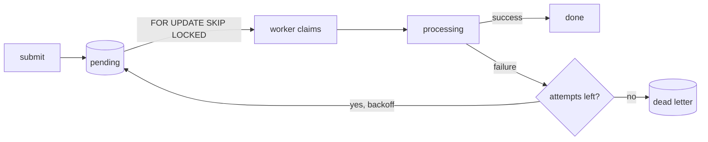
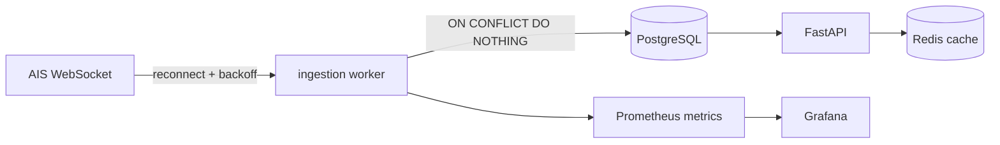

# Panagiotis Panageas

**Python developer — backend and automation.**

---

## About

I'm a Python developer: I work as a back end developer at FlameVerse AI, a career-guidance platform, and I run Hutsix as my own commercial product. My work is mostly backend services and automation: FastAPI and SQLAlchemy services, asyncio workers, pytest suites, and the occasional PySide6 desktop app. On Hutsix I wrote the core and the UI myself and used AI assistance for much of the rest; in Conductor, feedstream and my other repositories I specified the architecture and AI wrote most of the implementation, which I review, test and operate. I'm early in my career and don't claim senior-level experience — everything below is something I can walk through in an interview.

---

## Projects

### Hutsix

A Windows desktop automation app written in Python with PySide6, sold commercially since 2026 and currently at 18 releases. I wrote its core and its UI myself, with AI assistance for much of the remaining code; profiles bind triggers (hotkeys, pixel colour, OpenCV template matching, OCR text, AI image triggers) to recorded keyboard and mouse actions, with cooldowns and a focus guard. Source is private — see the [showcase and MSI downloads](https://github.com/Archangel-77/hutsix-public) or the [storefront](https://panpanageas.gumroad.com/l/rrstan).

Everything else below follows one pattern: I specify the architecture and behaviour, AI writes most of the code, and I review, test and run it.

### Conductor

An async task queue for Python that uses PostgreSQL instead of Redis or a broker, published on PyPI as [`conductor-task-queue`](https://pypi.org/project/conductor-task-queue/). Workers claim a task and mark it processing in the same statement, so two workers cannot take the same row. Retries default to exponential backoff, exhausted tasks go to a dead-letter queue, and recurring tasks, priority routes and per-task-type circuit breakers are built in. About 11,600 lines of Python with roughly as much test code: [Archangel-77/conductor](https://github.com/Archangel-77/conductor).

### feedstream

A Python service that ingests live AIS ship positions over a WebSocket and serves them through FastAPI. Writes are deduplicated on an MMSI / message-type / timestamp key, so a replay inserts nothing; the upstream connection retries with random exponential backoff behind a circuit breaker, and Redis caches query results.

[Archangel-77/feedstream](https://github.com/Archangel-77/feedstream)

### task-manager-api

A small FastAPI service with async SQLAlchemy, JWT auth, Alembic migrations and `owner_id` filtering on every task query. The pytest suite covers authentication and CRUD: [Archangel-77/task-manager-api](https://github.com/Archangel-77/task-manager-api).

### agent-pr-firewall

A TypeScript GitHub App that verifies webhook signatures, checks each pull request against policies (secret patterns, protected paths, missing issue reference, PR size, draft status) and publishes the result as a check run: [Archangel-77/agent-pr-firewall](https://github.com/Archangel-77/agent-pr-firewall).

---

## Skills

| Solid | Working knowledge | Learning |
| :---- | :---------------- | :------- |
| Python | asyncio | PyTorch |
| FastAPI | Alembic | Prometheus |
| SQLAlchemy | Redis | TypeScript |
| PostgreSQL | Docker | |
| pytest | GitHub Actions | |
| PySide6 | OpenCV | |
| Git | | |

---

## Education

**B.Sc. Computer Science** — Hellenic Open University, in progress (October 2022 – expected June 2028).

---

## Contact

**Open to freelance and contract roles — remote only.**

[panpanageas@gmail.com](mailto:panpanageas@gmail.com) · [LinkedIn](https://www.linkedin.com/in/panagiotis-panageas-017ba1213) · [CV](https://archangel-77.github.io/Archangel-77/cv/)